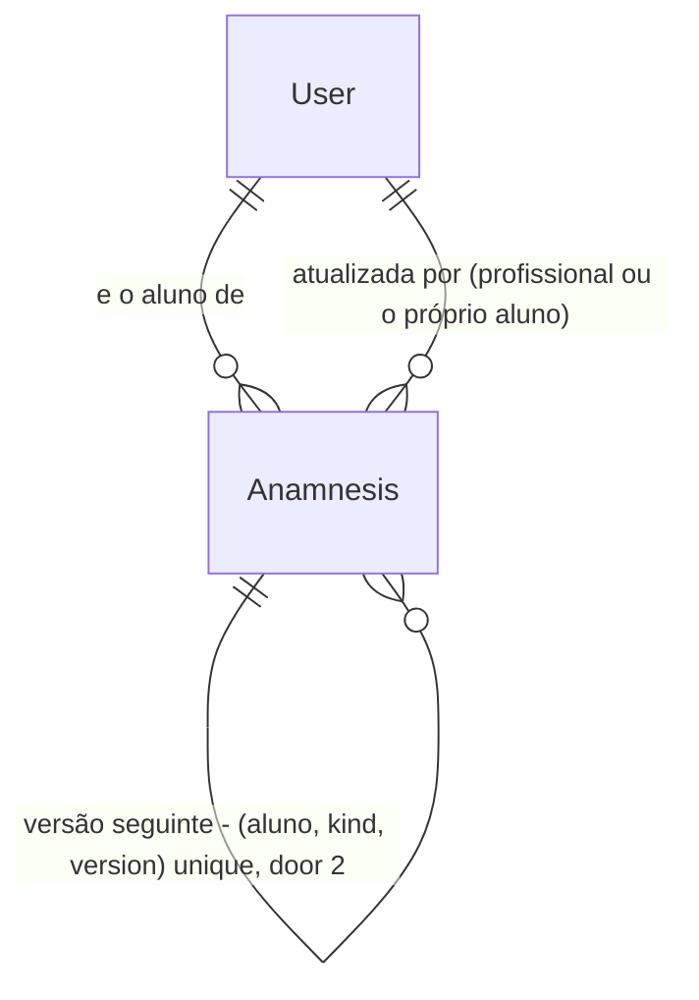

# Anamnese do profissional

## Problem

Hoje o profissional não tem uma ficha única do aluno para a primeira consulta. As informações que
ele precisa estão espalhadas em endpoints soltos de Nutrição, todos presos ao vínculo de nutrição:
restrições e alergias são dois textos livres no `NutritionProfile` (`PUT /api/nutrition/profile/restrictions`,
`PUT /api/nutrition/users/{id}/restrictions`), as medidas são uma lista só de Nutrição
(`/api/nutrition/users/{id}/measurements`) e o plano prescrito é só o plano alimentar
(`/api/nutrition/users/{id}/meal-plans`). O treinador não tem nada equivalente: não registra
lesões, medicamentos, histórico de saúde nem objetivos do aluno, nem vê as medidas ou o plano de
treino do aluno num lugar só. Cada texto é sobrescrito sem histórico, então o profissional não sabe
o que o aluno respondia quando o plano foi prescrito.

O app mobile exibia essas telas soltas (plano prescrito, restrições e alergias, medidas) na aba
Conta do aluno; elas foram retiradas até esta spec existir, porque a ficha precisa ser desenhada
uma vez para treinador e nutricionista, não duas. Não há evidência numérica na origem (pedido do
dono do produto).

Quando isto entrar: nutricionista e treinador abrem uma ficha por aluno, com as respostas do
aluno, o que o profissional completou, as últimas medidas e o plano ativo, e conseguem ver o que
mudou ao longo do tempo.

## Flow

Reaproveita `NutritionAccessPolicy` e o `TrainerClientRepository` (quem pode ver o aluno), o
`ProfessionalCapabilityService` (quem é profissional) e as leituras já existentes de medidas e
planos, em vez de duplicá-las.

1. `PUT /api/anamnesis/{kind}/users/{targetUserId}` -> `AnamnesisAccessPolicy` (new, door 1) - decide: o próprio aluno, ou profissional com a capacidade do `kind` e vínculo ativo daquele `kind` (nutrição: `ProfessionalClientRelationship` ativo; treino: `TrainerClient.IsActive`)
2. `AnamnesisAccessPolicy` (new, door 1) -> `NutritionAccessPolicy` (exists) para `nutrition`, `TrainerClientRepository` (exists, filtrando `IsActive`) para `training`
3. `SaveAnamnesisHandler` (new, door 2) - valida as respostas do `kind`, confere `expectedVersion`, grava uma nova versão imutável de `Anamnesis` (door 2)
4. out: a versão gravada; `GET .../users/{targetUserId}` lê a última versão, junta a última medida (`NutritionMeasurement`, exists) e o resumo do plano ativo (`MealPlan` ou `WorkoutPlan`, exists) e devolve a ficha
5. `GET .../versions` lista as versões do `kind` por `Version` decrescente, e `GET .../versions/{version}` devolve uma

## Impact

| Front | What changes |
| --- | --- |
| domain | new term: `Anamnesis` - ficha de um aluno para um tipo de profissional (`kind`), com versões imutáveis, lives in Features/Anamnesis |
| domain | existing term: `Restrictions`/`Allergies` do `NutritionProfile` eram texto editável no lugar, passam a ser o campo `restrictions`/`allergies` da anamnese de nutrição - quem lê hoje: `GET /api/nutrition/profile`, `GET /api/nutrition/users/{id}/profile`, o web (ShapeUp-Web) |
| domain | existing term: o app mobile deixou de mostrar plano prescrito, restrições e medidas na aba Conta; esta spec define onde voltam |
| stored data | restrições e alergias existentes: migrar na leitura (a primeira leitura sem versão devolve o texto do `NutritionProfile` como versão 0, sem gravar); nenhum backfill |
| stored data | os endpoints `PUT .../restrictions` continuam e passam a gravar uma nova versão da anamnese de nutrição; `NutritionProfile.Restrictions`/`Allergies` viram projeção da última versão, gravada na mesma transação da nova versão (uma unidade de escrita, sem duas fontes que divirjam) |

## Relations

One-way constraints: (`ClientUserId`, `Kind`, `Version`) unique (door 2); `Kind` é `Nutrition` ou
`Training` (door 3); uma versão gravada nunca é alterada nem apagada (door 2). No columns and no
types here.

## Surface

| Route | In | Out | Status |
| --- | --- | --- | --- |
| `GET /api/anamnesis/{kind}/users/{targetUserId}` | `kind`, `targetUserId` | `version` · `answers` · `updatedAtUtc` · `updatedByUserId` (só para o profissional) · `measurements` · `activePlan` (nutrição) ou `latestPlan` (treino) | `200`, `400`, `403` |
| `PUT /api/anamnesis/{kind}/users/{targetUserId}` | `expectedVersion`, `answers` | `version` · `answers` · `updatedAtUtc` | `200`, `400`, `403`, `409` |
| `GET /api/anamnesis/{kind}/users/{targetUserId}/versions` | `cursor`, `pageSize` | `items[version, updatedAtUtc, updatedByUserId]` · `nextCursor` | `200`, `400`, `403` |
| `GET /api/anamnesis/{kind}/users/{targetUserId}/versions/{version}` | `version` | `version` · `answers` · `updatedAtUtc` · `updatedByUserId` | `200`, `400`, `403`, `404` |

## Landing

| One-way door | Literal shape | Alternative rejected |
| --- | --- | --- |
| 1 - quem acessa a ficha | `AnamnesisAccessPolicy.CanAccess(actor, target, kind)`: `actor == target`, ou capacidade do `kind` e vínculo ativo do `kind` (para `training`: `TrainerClient` com `IsActive`); senão 403 | checar só o `Nutrition` como hoje: não cobre o treinador, que usa `TrainerClient` e não `ProfessionalClientRelationship` |
| 2 - versões imutáveis | tabela `Anamnesis` com índice único `(ClientUserId, Kind, Version)`, só `INSERT`, a última versão é a de maior `Version`, gravar exige `expectedVersion == última` (senão 409) | documento único editável no lugar: perde o que o aluno respondia quando o plano foi prescrito e não detecta duas pessoas editando ao mesmo tempo |
| 3 - tipos de ficha | `Kind` = `Nutrition` \| `Training`, o mesmo texto de `NutritionAccessPolicy.RelationshipType` e rota em minúsculas `nutrition` \| `training` | uma ficha única com seções por profissão: cada profissão veria o que a outra escreveu, e o consentimento do aluno é por vínculo |

- Nothing else in this change is hard to reverse

## Criteria

### S1: o nutricionista e o aluno mantêm a anamnese de nutrição (P1)

O aluno e o nutricionista vinculado leem e gravam a ficha de nutrição, com restrições e alergias.

**Acceptance Criteria**

1. WHEN o aluno ou o nutricionista com vínculo ativo faz `GET /api/anamnesis/nutrition/users/{id}` e não há versão gravada THEN the system SHALL responder `200` com `version` 0 e `answers.restrictions` e `answers.allergies` iguais ao texto do `NutritionProfile` (vazios se não houver)
2. WHEN o aluno ou o nutricionista com vínculo ativo faz `PUT` com `expectedVersion` igual à versão atual e `answers` válidas THEN the system SHALL gravar a versão `expectedVersion + 1` e responder `200` com essa versão
3. IF o `expectedVersion` do `PUT` é diferente da versão atual THEN the system SHALL responder `409` e não gravar nada
4. IF `answers` de nutrição tem uma chave fora de `goals`, `restrictions`, `allergies`, `intolerances`, `medications`, `conditions`, `mealsPerDay`, `notes` THEN the system SHALL responder `400` e não gravar
5. IF um texto de `answers` passa de 1000 caracteres, ou `mealsPerDay` está fora de 1 a 12 THEN the system SHALL responder `400` e não gravar
6. WHEN o `PUT` de nutrição grava a versão THEN the system SHALL atualizar `NutritionProfile.Restrictions` e `NutritionProfile.Allergies` para `answers.restrictions` e `answers.allergies` na mesma transação, e se uma das duas gravações falha nenhuma é aplicada
7. WHEN `PUT /api/nutrition/profile/restrictions` ou `PUT /api/nutrition/users/{id}/restrictions` é chamado THEN the system SHALL gravar uma nova versão da anamnese de nutrição sobre a versão mais recente lida naquele instante, com esses dois campos trocados e os demais mantidos
7a. IF outra gravação criou uma versão entre a leitura e a escrita do endpoint legado THEN the system SHALL repetir a leitura e a escrita, no máximo 3 vezes, e responder `409` se ainda assim perder

### S2: o treinador e o aluno mantêm a anamnese de treino (P1)

O aluno e o treinador vinculado leem e gravam a ficha de treino, com lesões e saúde.

**Acceptance Criteria**

8. WHEN o aluno ou o treinador com `TrainerClient.IsActive` faz `GET /api/anamnesis/training/users/{id}` e não há versão gravada THEN the system SHALL responder `200` com `version` 0 e `answers` vazias
9. WHEN o aluno ou o treinador vinculado faz `PUT` com `expectedVersion` igual à versão atual e `answers` válidas THEN the system SHALL gravar a versão seguinte e responder `200`
10. IF `answers` de treino tem uma chave fora de `goals`, `injuries`, `conditions`, `medications`, `trainingExperience`, `weeklyAvailability`, `parqAnswers`, `notes` THEN the system SHALL responder `400` e não gravar
11. IF `weeklyAvailability` está fora de 0 a 7 dias, ou `parqAnswers` não tem exatamente 7 respostas booleanas THEN the system SHALL responder `400` e não gravar

### S3: acesso e isolamento (P1)

Cada profissional só vê a ficha do seu tipo, do aluno que está vinculado a ele.

**Acceptance Criteria**

12. IF quem chama não é o aluno nem um profissional com a capacidade e o vínculo ativo do `kind` da rota THEN the system SHALL responder `403` em todas as rotas de anamnese
13. IF o vínculo do profissional com o aluno foi encerrado THEN the system SHALL responder `403` e não devolver nenhuma versão
14. IF `kind` não é `nutrition` nem `training` THEN the system SHALL responder `400`
15. WHEN o nutricionista chama qualquer rota com `kind` `training`, ou o treinador com `kind` `nutrition`, THEN the system SHALL responder `403`, e nenhuma resposta da ficha de um `kind` contém campo da ficha do outro

### S4: a ficha junta medidas e plano ativo (P2)

Quem abre a ficha vê, sem outra tela, a última medida e o plano ativo do aluno.

**Acceptance Criteria**

16. WHEN a ficha de nutrição é lida THEN the system SHALL devolver `measurements` com a medida mais recente do aluno (`date`, `weightKg`, `bodyFatPercent`) ou `null` se não houver
17. WHEN a ficha de nutrição é lida THEN the system SHALL devolver `activePlan` com `id` e `name` do plano alimentar ativo, ou `null` se não houver
18. WHEN a ficha de treino é lida THEN the system SHALL devolver `latestPlan` com `id` e `name` do plano de treino alterado por último (`UpdatedAtUtc`) do aluno, ou `null` (não existe plano de treino "ativo"), e `measurements` com a última medida do aluno ou `null`

### S5: histórico de versões (P2)

O profissional vê o que mudou e consulta o que o aluno respondia numa data.

**Acceptance Criteria**

19. WHEN o profissional faz `GET .../versions` THEN the system SHALL listar as versões do `kind` por `version` decrescente, com paginação por cursor
20. WHEN o profissional faz `GET .../versions/{version}` de uma versão existente THEN the system SHALL devolver as `answers` exatamente como foram gravadas
21. IF a `version` pedida não existe, incluindo `0` (a versão 0 só existe como resposta do `GET` principal e nunca é gravada), THEN the system SHALL responder `404`
22. The system SHALL nunca alterar uma versão já gravada, e só apagar versões quando o aluno exclui a própria conta (todas as do aluno, de uma vez), nunca quando o vínculo do profissional termina
22a. WHEN o aluno lê a própria ficha THEN the system SHALL omitir `updatedByUserId` das versões gravadas por profissional

## Out of scope

| Excluded | Why |
| --- | --- |
| o treinador registrar medidas novas | hoje só a Nutrição grava medidas; abrir isso ao treino muda quem pode escrever dado corporal e merece o seu próprio plano |
| o aluno ver a ficha do profissional no app | a ficha é do profissional; o aluno preenche as próprias respostas, e a tela dele é outra fatia |
| exportar a ficha em PDF | não pedido; reversível depois |
| formulários configuráveis por profissional | as chaves de cada `kind` são fixas nesta spec |
| telas no app mobile | o app só volta a exibir isto depois que esta API existir |

## Assumptions

| Assumption | Chosen default | Rationale | Confirmed? |
| --- | --- | --- | --- |
| uma ficha por profissão ou uma ficha única | uma ficha por `kind`, e cada profissional só vê a do seu `kind` | o aluno consente por vínculo; treinador não deve ler o que o nutricionista anotou | n |
| restrições e alergias: lista ou texto | texto livre, como hoje | evita converter dados existentes e manter dois formatos | n |
| medidas e plano: a ficha guarda cópia ou só consulta | só consulta (não copia nada) | uma fonte de verdade; a ficha mostra o dado vivo | n |
| a ficha de treino mostra medidas gravadas pela Nutrição | sim, a última medida do aluno, para o treinador vinculado; é a única exceção ao isolamento entre profissões | o aluno vinculou os dois; medida corporal é dado do aluno, não do nutricionista (decisão a confirmar, ver critério 15) | n |
| o aluno pode editar a própria ficha | sim, nos dois `kind` | o aluno é quem sabe as respostas; o profissional completa | n |
| apagar o aluno (LGPD) | a exclusão de conta do aluno apaga todas as versões dele (critério 22); o fluxo de exclusão em si é outra spec | dado de saúde não deve sobreviver ao titular; o caminho de exclusão será ligado pela outra spec | n |
| consentimento e auditoria de leitura (LGPD) | o vínculo ativo é o consentimento; sem trilha de leitura nem retenção após o fim do vínculo nesta spec | fatia própria, pois exige decisão jurídica; fica registrado como lacuna | n |
| lista de chaves de cada `kind` | a do critério 4 e 10; ajustável antes de construir | a nutricionista e o treinador devem revisar o que perguntar | n |

**Open questions:** none blocking - every default above is logged with `Confirmed? n` and waits for review (the product owner, the nutritionist and the trainer should confirm the answer keys and the cross-profession measurement sharing).

## Observable

| Surface | Decision | Landing |
| --- | --- | --- |
| API `GET /api/anamnesis/{kind}/users/{id}` | primeira leitura sem versão | AC 1, AC 8 |
| API `PUT /api/anamnesis/{kind}/users/{id}` | formato do erro e códigos | AC 3, AC 4, AC 5, AC 10, AC 11 |
| API `/api/anamnesis/*` | quem pode chamar | AC 12, AC 13, AC 15 |
| API `/api/anamnesis/*` | `kind` inválido | AC 14 |
| API `GET .../versions/{version}` | versão que não existe | AC 21 |
| API `GET .../versions` | paginação | AC 19 |
| all new `/api/anamnesis/*` | versionamento da API, limite de requisições | n/a - segue o padrão das rotas de Nutrição, que não têm nenhum dos dois |
| API `PUT /api/anamnesis/*` | duas pessoas editando ao mesmo tempo | AC 3 |

## Sources

- pedido do dono do produto (chat, 07/10/2026) - ficha de anamnese para treinador e nutricionista com plano prescrito, alergias, restrições e medidas; telas removidas do app até existir
- `Features/Nutrition` (Profile, Measurements, MealPlans, `NutritionAccessPolicy`) e `Features/GymManagement/TrainerClients` - o que existe hoje
