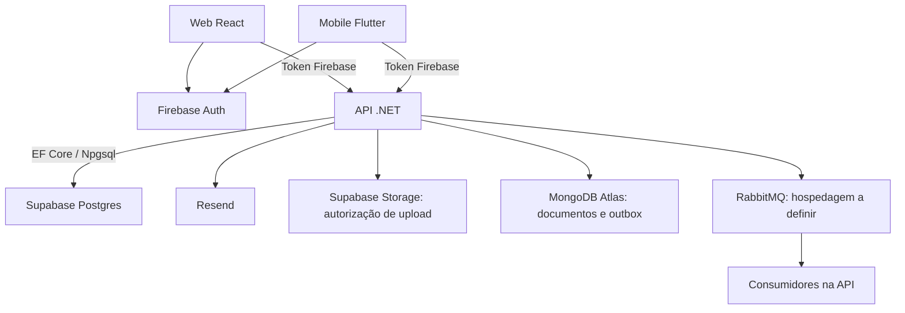

# ShapeUp: infraestrutura para validar e monetizar

Data: 18/10/2026. Estudo e recomendação; nenhuma migração foi executada ou aprovada por este documento.

## Conclusão

Diretriz em avaliação: **manter MongoDB no beta e comparar o custo pago antes de assumir sua permanência**. Veja a análise econômica abaixo. Recomendo **Firebase Auth + API .NET existente + MongoDB Atlas + Postgres gerenciado no Supabase**, com Supabase Storage caso uploads sejam necessários no beta. A migração proposta fica limitada ao SQL Server; substituir a API inteira por serviços Supabase não é necessário para isso.

O maior obstáculo ao custo zero é a combinação de bancos, broker e processamento contínuo, e não o Firebase Auth. A arquitetura atual tem mais componentes operacionais do que a validação inicial exige. Há, porém, garantias importantes implementadas nessa infraestrutura: simplificar não pode perder treinos, duplicar séries ou conceder XP repetido.

Manter MongoDB preserva os repositórios de documentos, os IDs, as operações atômicas e a outbox existentes. Sugiro uma transição delimitada de SQL Server para Postgres antes de levar usuários à nova infraestrutura. Não vale reescrever meses de produto para economizar uma pequena mensalidade.

## Escopo e evidências

Foram inspecionados o backend ShapeUpV2, dependências e pontos de autenticação/upload dos projetos ShapeUp-Web e ShapeUp-Mobile, além do roadmap e documentação de arquitetura. Não houve acesso aos consoles cloud, faturamento, volumes reais de dados ou métricas de carga. Configuração local não comprova o que está provisionado em produção. Testes não foram executados: este trabalho é uma análise estática e documental.

| Componente observado | Responsabilidade atual | Evidência no backend ou cliente |
|---|---|---|
| ASP.NET Core 10 | API e regras de negócio | `src/ShapeUp.csproj`, `src/Program.cs` |
| Firebase Auth | Login, validação de tokens, custom claims e revogação | `src/Features/Authorization/Infrastructure/Firebase/FirebaseService.cs` |
| SQL Server / EF Core | Autorização, auditoria, academias, gamificação, parte da nutrição e treino, credenciais, relacionamentos e flags | Nove DbContexts em `src/Configurations/DatabaseMigrationExtensions.cs` |
| MongoDB | Fichas, sessões, templates, alimentos, planos alimentares, hidratação, peso e outbox | Repositórios em `Training/Infrastructure/Mongo` e `Nutrition/Infrastructure/Mongo`; `MessagingExtensions.cs` |
| RabbitMQ / MassTransit | Eventos, consumidores de gamificação e agendamento nutricional | `src/Configurations/MessagingExtensions.cs` |
| Firebase Storage | Foto de perfil nos dois clientes | Web: `src/contexts/AuthContext.jsx`; mobile: `lib/services/auth_controller.dart` |
| Resend | E-mails transacionais | `src/Features/Notifications/Infrastructure/Resend` |
| OpenTelemetry / Seq | Instrumentação e destino local de telemetria | `src/Configurations/ObservabilityExtensions.cs`, `src/docker-compose.yml` |
| React/Vite e Flutter | Web e aplicativo | Manifests dos dois repositórios |

Não encontrei Firestore como banco de negócio nos pontos inspecionados. Portanto, a mudança principal seria **SQL Server → Postgres, mantendo MongoDB**, e não Firestore → Supabase.

O roadmap já prevê beta por convite, lançamento gratuito do aluno e monetização posterior. Chat, vídeo, IA, marketplace e superfícies profissionais ficam fora do lançamento inicial. Isso favorece reduzir a infraestrutura sem reduzir o logger, a nutrição básica e a gamificação já prometidos.

## Comparação das alternativas

| Alternativa | Trabalho inicial | Operação posterior | Parecer |
|---|---|---|---|
| Manter tudo | Menor alteração de código; ainda exige resolver hospedagem de cada serviço | Vários limites, backups e conexões | Válida se a infraestrutura já estiver disponível; pouco alinhada ao objetivo de simplificar |
| Firebase Auth + MongoDB + Postgres/Supabase + .NET | Migração do relacional; documentos e outbox preservados | Dois bancos com responsabilidades existentes | Direção recomendada com a decisão de manter MongoDB |
| Migrar também para Supabase Auth | Inclui mudanças nos dois clientes, tokens, contas e claims | Menos fornecedores | Benefício inicial insuficiente para justificar essa frente adicional |
| Remover .NET e acessar Supabase diretamente | Reescrita de regras, autorização e contratos | Parte da operação passa à plataforma | Não recomendo para lançar o produto atual |

Supabase é uma plataforma que inclui Postgres. Pode ser usado somente como banco gerenciado: o EF Core conecta ao Postgres e a API continua validando o token Firebase. Isso não exige Supabase Auth. A integração oficial com Firebase é relevante se os clientes forem acessar Storage ou Data API diretamente; nesse caso há configuração de tokens, claims e políticas de acesso. [Documentação da integração](https://supabase.com/docs/guides/auth/third-party/firebase-auth).

## Arquitetura recomendada

Manter a autorização de negócio na API. As capacidades, credenciais profissionais, vínculos e entitlements atuais não são substituídos pelo simples fato de ativar RLS no Supabase. Tabelas acessadas somente pelo backend devem ficar fora da exposição pública desnecessária. Credenciais administrativas e de banco permanecem no servidor.

Para fotos, a API pode autorizar uploads limitados e emitir URLs assinadas. Isso preserva Firebase Auth sem obrigar uma segunda autenticação no cliente. A integração direta Firebase/Supabase é outra opção, mas precisa ser confrontada com as custom claims existentes. Definir privacidade por tipo de arquivo; documentos profissionais e imagens pessoais não devem herdar automaticamente uma política pública.

## O que pode custar zero — e sob quais condições

| Serviço | Limite ou condição consultada | Implicação |
|---|---|---|
| Supabase Free | 500 MB de banco, 1 GB de arquivos, 5 GB de egress e franquia separada de 5 GB de cached egress; 50 mil MAU de Auth | Bom candidato ao beta; capacidade real depende de dados, índices e uso |
| Supabase Free | Até dois projetos ativos; pausa após uma semana de inatividade | Aceitar pausa e manter exportação recuperável dos dados |
| Firebase Auth | A maioria das modalidades de autenticação tem uso sem custo; telefone tem cobrança específica | Preservar o login atual e evitar SMS como requisito do beta |
| Firebase Storage | Exige Blaze, inclusive para acesso ao bucket padrão | Franquia gratuita não equivale a operar sem conta de faturamento |
| Render Free para API | 750 horas por workspace/mês; dorme após 15 minutos sem tráfego; inicialização pode levar cerca de um minuto | Candidato apenas para beta que aceite espera; jobs não podem depender de execução contínua |
| Resend Free | 3 mil e-mails/mês, teto de 100/dia | Compatível com convites de um grupo pequeno, dentro da franquia |

Fontes: [Supabase planos](https://supabase.com/pricing), [Supabase franquias](https://supabase.com/docs/guides/platform/billing-on-supabase), [Firebase planos](https://firebase.google.com/docs/projects/billing/firebase-pricing-plans), [mudança do Storage](https://firebase.google.com/docs/storage/faqs-storage-changes-announced-sept-2024), [Render Free](https://render.com/docs/free), [Resend](https://resend.com/pricing).

Os 50 mil MAU não são promessa de que este sistema comportará 50 mil usuários gratuitamente. Banco, índices, imagens, tráfego e concorrência podem limitar muito antes. Usuários do Firebase acessando somente a API .NET não passam automaticamente a ser usuários do Supabase Auth.

Para o frontend React/Vite, Firebase Hosting é um candidato natural, dentro da franquia do Spark. Ele hospeda os arquivos web; não hospeda a API .NET. Usar o subdomínio fornecido evita exigir domínio pago na validação. [Franquias do Hosting](https://firebase.google.com/docs/hosting/usage-quotas-pricing).

Render Free não oferece uma instância confiavelmente ativa para consumidores e timers. Também não guardar arquivos ou SQLite no disco efêmero. Seu Postgres gratuito expira após 30 dias; não o escolher como banco permanente deste beta. Antes de adotar a API gratuita, medir memória, tempo de inicialização e comportamento do primeiro acesso com o aplicativo real.

Cloud Run é alternativa se aceitar conta de faturamento e consumo variável: há franquia, mas ela não garante fatura zero e serviços auxiliares também podem cobrar. Consumidores contínuos exigem outro desenho de execução. [Preço do Cloud Run](https://cloud.google.com/run/pricing), [exigência de billing](https://docs.cloud.google.com/docs/get-started/learn-about-billing).

## Por que a migração exige cuidado

### SQL Server

Há nove DbContexts, embora compartilhem a configuração de conexão. A quantidade de contextos não é motivo para fundir todos os domínios: podem compartilhar um Postgres preservando a organização existente.

A troca envolve provider Npgsql compatível com EF Core 10, novas migrations e validação das consultas. Há filtros com sintaxe SQL Server em Credentials, Relationships e Nutrition; `RowVersion` em Credentials; e `UPDLOCK/HOLDLOCK` no onboarding nutricional. A proteção contra concorrência precisa ser redesenhada e testada em Postgres, inclusive conflitos de serialização e retentativas. Não basta substituir `UseSqlServer`.

Revisar identidade de IDs, datas, precisão decimal, comparação de strings, índices únicos, paginação e histórico de migrations por contexto. Preparar o schema fora da inicialização de cada instância; hoje o startup aplica migrations de todos os contextos. Usar conexão adequada ao ambiente, com pool pequeno: o pooler em modo sessão permite IPv4 quando necessário. [Conexões Supabase](https://supabase.com/docs/guides/database/connecting-to-postgres).

O compose usa SQL Server **Developer**, destinado a desenvolvimento/testes. Não assumir que esse mesmo container é a opção gratuita de produção. A edição Express é uma alternativa de licença gratuita, mas continua exigindo hospedagem. [Edições Microsoft](https://learn.microsoft.com/en-us/sql/sql-server/editions-and-components-of-sql-server-2025).

### MongoDB

**MongoDB permanece como candidato para o beta**, usando o free tier do Atlas. A permanência depois da validação depende da comparação econômica abaixo. Não há migração de documentos executada ou autorizada neste estudo.

O projeto contém dez implementações de repositório Mongo: três em treino e sete em nutrição. Preservar sessões, fichas, templates, alimentos, planos, hidratação, peso e outbox evita uma frente significativa de reescrita.

`MongoWorkoutSessionRepository` aplica operações de séries com deduplicação por `operationId`; `IWorkoutSessionRepository` expõe `IClientSessionHandle`; `MongoMealPlanRepository` usa transação para manter ativação exclusiva. Esses contratos e comportamentos permanecem.

Antes de publicar, validar os limites do Atlas Free contra o volume real, transações, criação de índices e outbox do ShapeUp, além de configurar acesso de rede e backup recuperável. A existência de uma franquia não comprova por si só a capacidade para o workload. [Limites Atlas Free](https://www.mongodb.com/docs/atlas/reference/free-shared-limitations/).

### Eventos e tarefas

MassTransit usa outbox Mongo mesmo quando o transporte é `InMemory`. Portanto, **selecionar InMemory não remove MongoDB nem conserva a durabilidade do broker**. Há consumidores de treino e nutrição que afetam gamificação, uma tarefa diária nutricional e expiração horária de credenciais.

Manter MongoDB não resolve automaticamente a hospedagem do RabbitMQ nem a execução contínua dos consumidores. A diretriz inicial é preservar a outbox Mongo e avaliar hospedagem do broker separadamente. Se remover RabbitMQ for necessário para caber no orçamento, será preciso provar uma alternativa durável de entrega, retentativas e deduplicação; não transferir a outbox para Postgres por padrão, pois o encerramento de treino continua no Mongo e isso perderia a transação compartilhada atual.

Um job agendado independente pode executar trabalho quando a API dorme; a escolha do agendador e sua franquia precisam ser validadas.

Outra opção é executar pequenas atualizações essenciais durante a requisição, desde que a consistência seja preservada e o custo medido. Não transformar todos os eventos em chamadas síncronas indiscriminadamente. Gamificação nutricional e credenciais também precisam de reconciliação por tempo: não basta tratar apenas o encerramento do treino.

Manter OpenTelemetry e logs estruturados. Seq no compose é o destino local; não há necessidade demonstrada de operar um servidor Seq dedicado no beta.

## Sequência proposta e critérios de conclusão

1. **Inventariar o ambiente real:** projetos cloud, usuários existentes, tamanho dos dois bancos, tamanho do catálogo e imagens, faturamento habilitado e necessidade de preservar dados. Não resetar dados sem essa resposta.
2. **Provar o caminho crítico com Postgres e MongoDB:** login Firebase → usuário → iniciar treino → registrar série com retry → finalizar → conceder XP uma vez → recuperar última carga. Incluir reinício/falha no processamento de eventos.
3. **Migrar o relacional:** preparar schema e carga, validar conflitos, índices, onboarding e autorização. Comparar contagens e amostras; manter origem recuperável.
4. **Validar MongoDB Atlas e mensageria:** manter documentos, IDs e contratos HTTP; validar transações, outbox, reconexão, nutrição, hidratação, peso e plano ativo. Definir a hospedagem do RabbitMQ ou provar uma alternativa durável antes de removê-lo.
5. **Resolver mídia e tarefas:** migrar ou adiar uploads, testar acesso privado, retentativas, trabalho atrasado e recuperação após inatividade.
6. **Publicar beta fechado:** sugestão inicial de 10–30 convidados, como limite operacional do experimento, não como capacidade comprovada da franquia. Medir erros, latência após suspensão, crescimento de dados, retorno ao app e treinos concluídos.

Antes de apontar os clientes para o novo ambiente: restaurar um backup em ambiente separado, comparar resultados dos fluxos essenciais e garantir rollback preservando dados escritos depois da virada. Se houver usuários ativos, será necessário planejar janela de escrita ou sincronização; manter o banco antigo sozinho não resolve rollback de novas gravações.

Não estimar prazo de migração sem a prova do caminho crítico e sem saber se existem dados reais. Se o beta tiver data próxima e infraestrutura já paga/disponível, validar usuários antes da migração do relacional pode ser a escolha mais econômica em tempo.

## Preparação para cobrança

O roadmap já separa lançamento grátis e monetização leve. Há `PlatformTier` e `Entitlements`, mas o adapter ainda usa um mapeamento fixo de capacidades. Isso é base de autorização, não um sistema completo de cobrança.

Ao chegar à fase paga, escolher um gateway e modelar assinatura, cliente externo, eventos recebidos, status e períodos de acesso. O backend valida a autenticidade do webhook, deduplica entregas e atualiza o entitlement; redirecionamento de checkout não comprova pagamento. Prever atraso, cancelamento, reembolso e reconciliação. Pix anual e assinatura mensal têm ciclos diferentes.

Não é necessário escolher o gateway para escolher Postgres. Não foram pesquisadas tarifas ou regras de lojas neste estudo; devem ser verificadas antes de implementar vendas no aplicativo. Publicação em lojas e domínio próprio também não estão incluídos no objetivo de infraestrutura gratuita. O beta web permite testar valor antes desses compromissos, embora não substitua validar recursos nativos.

Supabase Pro começa em US$ 25/mês na configuração básica publicada, com condições de compute e uso adicionais. Esse é um componente do orçamento futuro, não o custo total do ShapeUp. Antes de depender de cobrança recorrente, reservar orçamento para API estável, banco, backups e monitoramento. Não esperar a primeira receita para descobrir que um webhook ou tarefa crítica não executa enquanto a API dorme. [Preços Supabase](https://supabase.com/pricing).

## Condições que mudariam a recomendação

- Infraestrutura atual já disponível sem custo e beta urgente: manter temporariamente mais componentes.
- Dados relacionais e índices próximos da franquia: Supabase Free pode não atender nem com poucos usuários. Medir MongoDB separadamente, pois o catálogo permanece nele.
- Exigência de disponibilidade contínua desde o primeiro dia: retirar a hospedagem gratuita com suspensão da proposta.
- Prova de migração do relacional revela alto risco: postergar essa migração. MongoDB já permanece por decisão do usuário.

As três respostas ainda necessárias para fechar a implantação são: quais dados reais existem, se aceita suspensão/espera no beta e se “sem custo” permite conta de faturamento com possibilidade de excedentes. Este estudo assume validação pequena, com interrupções toleráveis e preferência por serviços que não exijam faturamento habilitado.

## Comparação econômica: MongoDB gratuito, Flex e dedicado

Consulta às fontes oficiais em 18/10/2026. Valores em USD, sem conversão cambial, impostos ou tarifas do meio de pagamento. São referências de catálogo, não cotação da região/provedor escolhidos.

### Até onde vai o gratuito

Atlas Free oferece 512 MB para documentos BSON não comprimidos **mais índices**, 100 operações/s e até 500 conexões. Há franquias independentes de 10 GB de entrada e 10 GB de saída em janela móvel de sete dias. Ao exceder limites de operações/tráfego ocorre limitação de velocidade; não se deve planejar o produto no teto. Pausa automática após 30 dias sem conexões. [Limites oficiais](https://www.mongodb.com/docs/atlas/reference/free-shared-limitations/).

Não há um limite equivalente a “X usuários grátis”. Catálogo, histórico, índices e outbox compartilham a capacidade; múltiplas conexões do backend não equivalem a usuários simultâneos.

Exemplo hipotético, não medição: reservando 200 MB para catálogo, índices e outros dados, sobram aproximadamente 300 MB. Se cada usuário gerar 16 treinos/mês com 20 KB por treino, serão cerca de 0,32 MB por usuário/mês: 100 usuários adicionariam aproximadamente 32 MB/mês somente em sessões. O espaço restante duraria cerca de nove meses nesse cenário simplificado. Nutrição, peso, novos índices e eventos reduzem esse prazo. Medir tamanho real dos documentos antes de usar esse exemplo como previsão.

### Degraus pagos

| Plano Atlas | Capacidade | Referência mensal |
|---|---|---|
| Free | 512 MB | US$ 0 |
| Flex | 5 GB; capacidade compartilhada | Cerca de US$ 8–30 |
| Dedicated M10 | Configuração inicial com 10 GB e 2 GB RAM | Cerca de US$ 60, variando por região/configuração |

No Flex, os patamares publicados para uso contínuo são aproximadamente US$ 8, 15, 21, 26 e 30 para faixas de até 100, 200, 300, 400 e 500 operações/s. A cobrança é horária e acompanha o uso: um pico temporário não transforma automaticamente o mês inteiro na faixa superior. O preço-base inclui transferência ilimitada pelo Atlas. M2/M5 e Serverless foram descontinuados; não usar tabelas antigas desses planos para decidir. [Custos Flex](https://www.mongodb.com/docs/atlas/billing/atlas-flex-costs/).

**US$ 30 não compra crescimento ilimitado.** Flex tem teto de 5 GB e 500 operações/s; ultrapassá-los exige otimizar ou mudar de categoria. Possui snapshots diários, mas não restauração contínua para um instante específico. [Limites Flex](https://www.mongodb.com/docs/atlas/reference/flex-limitations/).

O dedicado parte de US$ 0,08/h no catálogo; usando 730 horas, são US$ 58,40 de referência. Região, armazenamento, backups e transferência podem alterar o total. [Preços Atlas](https://www.mongodb.com/pricing).

### Comparação com Postgres no Supabase

Supabase Free inclui 500 MB de banco. Pro começa em US$ 25/mês para uma configuração básica com um projeto Micro e créditos de compute, com 8 GB de disco incluídos. Disco excedente custa US$ 0,125/GB/mês na configuração padrão; compute e outros excedentes são separados. [Preços Supabase](https://supabase.com/pricing).

| Cenário de bancos | Mongo gratuito | Mongo Flex | Mongo dedicado inicial |
|---|---:|---:|---:|
| Supabase relacional ainda gratuito + Mongo | US$ 0 | ~US$ 8–30 | ~US$ 60 + extras |
| Supabase Pro básico + Mongo | US$ 25 | ~US$ 33–55 | ~US$ 85 + extras |
| Tudo no mesmo Supabase Pro básico | US$ 25 | US$ 25 | US$ 25 |

A última linha pressupõe que **todos os dados e a carga caibam nessa configuração**, após a migração. Não representa equivalência de desempenho entre Micro e M10. Compartilhar banco também aumenta contenção entre consultas relacionais, documentos e eventos. Um upgrade de compute pode consumir a economia.

Exemplo: se consolidar no Postgres exigir Small, o total-base passa a cerca de US$ 30; com Medium, cerca de US$ 75, considerando plano de US$ 25, crédito de US$ 10 e compute publicado de US$ 15/60. Portanto, não comparar apenas gigabytes ou supor que US$ 25 cobre qualquer crescimento.

### Consequências específicas do ShapeUp

O código define `outbox.QueryDelay = 250 ms` em `src/Configurations/MessagingExtensions.cs`. Esse intervalo permite ciclos frequentes de consulta; o número real de operações depende do MassTransit e da carga. Medir no Atlas, com API ociosa e durante treinos. Réplicas adicionais podem aumentar polling e conexões. Não inferir ops/s a partir de chamadas HTTP.

A migração completa alcançaria dez repositórios, contratos com sessões Mongo e a transação de treino + outbox. A economia mensal precisa pagar essa engenharia e o risco de regressão. Fórmula simples: **prazo de retorno = custo da migração / economia mensal líquida**. Uma migração hipotética de US$ 500 para economizar US$ 8/mês demora 62,5 meses para retornar; com US$ 30/mês, 16,7 meses. Isso exclui manutenção e custo de oportunidade.

### Recomendação econômica revisada

- **Beta:** manter Atlas Free, desde que o teste real confirme compatibilidade e folga.
- **Primeiro upgrade:** Flex básico pode compensar mais que migrar o logger; US$ 8/mês isoladamente não justifica uma reescrita relevante.
- **Se já pagar Supabase:** avaliar a consolidação com mais atenção, porque Mongo passa a ser custo adicional; US$ 30/mês persistentes tornam essa revisão mais interessante.
- **Antes do teto do Flex:** comparar uma prova de carga no Postgres com uma cotação Atlas dedicado da região escolhida. Esse é o ponto de decisão mais forte.

Definir alertas internos antes do teto: por exemplo, revisar capacidade em 350–400 MB no Free e 3,5–4 GB no Flex. São margens propostas, não limites do provedor. Acompanhar também ops/s, latência, crescimento mensal, tráfego e acúmulo de eventos. Preservar histórico útil; limpar eventos técnicos concluídos somente conforme as garantias de retenção/deduplicação.

**Parecer:** Mongo pode continuar compensando quando começar a pagar, especialmente no Flex básico. Para longo prazo, dois bancos pagos tendem a custar mais que um Postgres suficiente para toda a carga. A decisão deve comparar economia líquida com esforço de migração, sem abandonar Mongo só por sair do gratuito nem mantê-lo indefinidamente só porque começou grátis.
